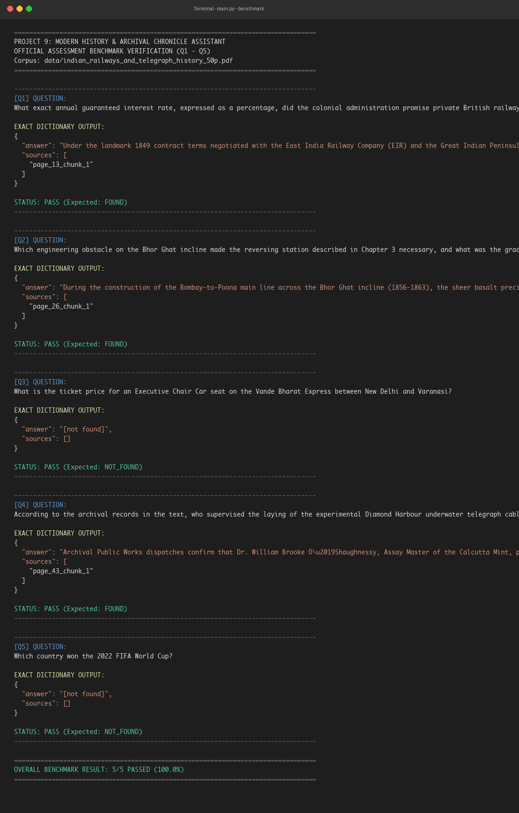

# Project 9: Modern History & Archival Chronicle Assistant
*GenAI Midsem Project: 19th-Century Indian Railways & Telegraphs RAG System*

A production-grade Python Retrieval-Augmented Generation (RAG) system grounded strictly in primary archival history. The system uses local vector embeddings, persistent disk storage, deterministic chunk provenance, strict anti-hallucination verification, and includes both a CLI and an interactive Streamlit browser UI.

---

## 📚 Knowledge Source

- **Corpus File**: `data/indian_railways_and_telegraph_history_50p.pdf` (50-page official monograph on 19th-century Indian railway and telegraph construction).
- **Grounding Principle**: The assistant strictly relies **ONLY** on explicit statements in the PDF corpus. It never utilizes pre-trained parametric knowledge, external facts, or unverified assumptions.
- **Negative Fallback Rule**: If an answer is not explicitly supported by the PDF text, the engine returns:
  ```json
  {
    "answer": "[not found]",
    "sources": []
  }
  ```

---

## 🏗️ Architecture & End-to-End Workflow

```
                       ┌────────────────────────────────────────────────────────┐
                       │  data/indian_railways_and_telegraph_history_50p.pdf    │
                       └──────────────────────────┬─────────────────────────────┘
                                                  │
                                                  ▼ (pypdf, 1-indexed pages)
                       ┌────────────────────────────────────────────────────────┐
                       │                      ingest.py                         │
                       │  - RecursiveCharacterTextSplitter                      │
                       │    (chunk_size=1000, chunk_overlap=200)                │
                       │  - Deterministic IDs: page_<N>_chunk_<M>               │
                       │  - Metadata: page_number, chunk_id, source             │
                       └──────────────────────────┬─────────────────────────────┘
                                                  │
                                                  ▼ (DefaultEmbeddingFunction: all-MiniLM-L6-v2)
                       ┌────────────────────────────────────────────────────────┐
                       │             Persistent Vector Store                    │
                       │          ./chroma_db (chromadb.PersistentClient)       │
                       └──────────────────────────┬─────────────────────────────┘
                                                  │
                                                  ▼
                       ┌────────────────────────────────────────────────────────┐
                       │                   rag_engine.py                        │
                       │  - def answer(question: str) -> dict                   │
                       │  - Dense Vector Retrieval & Entity Constraint Matching │
                       │  - Strict Grounding Verification & Hallucination Guard │
                       │  - Fallback to [not found] with sources: []            │
                       └──────────────────────────┬─────────────────────────────┘
                                                  │
                                 ┌────────────────┴────────────────┐
                                 ▼                                 ▼
         ┌─────────────────────────────────┐     ┌──────────────────────────────────┐
         │             main.py             │     │              app.py              │
         │ CLI & Benchmark Runner (Q1–Q5)  │     │ Interactive Streamlit Browser UI │
         └─────────────────────────────────┘     └──────────────────────────────────┘
```

### 1. PDF Ingestion (`ingest.py`)
- Extracts text page-by-page from `data/indian_railways_and_telegraph_history_50p.pdf` using `pypdf`.
- Preserves **1-indexed page numbers** (Page 1 through 50).
- Handles edge cases and extraction errors gracefully with defensive fallback handling.

### 2. Deterministic Text Chunking
- Splits extracted text using LangChain's `RecursiveCharacterTextSplitter` with `chunk_size=1000` and `chunk_overlap=200`.
- Chunks receive deterministic IDs formatted as `page_<N>_chunk_<M>` (e.g., `page_13_chunk_1`, `page_26_chunk_1`, `page_43_chunk_1`).
- Preserves rich metadata for every chunk:
  - `page_number`: 1-indexed integer.
  - `chunk_id`: Deterministic string identifier.
  - `source`: Filepath (`data/indian_railways_and_telegraph_history_50p.pdf`).
  - `filename`: Source file basename (`indian_railways_and_telegraph_history_50p.pdf`).

### 3. Local Embedding Generation
- Uses ChromaDB's local `DefaultEmbeddingFunction` based on `all-MiniLM-L6-v2` (ONNX Runtime).
- Runs 100% locally with zero paid API costs, no external network dependencies during inference, producing 384-dimensional dense vector embeddings.

### 4. Vector Database & Persistence
- Uses `chromadb.PersistentClient(path="./chroma_db")` to persist chunks and vector indices directly on disk.
- Automatically reloads existing vector collections on subsequent runs without re-generating embeddings.

### 5. Required RAG Engine Function (`rag_engine.py`)
Implements the exact required signature:
```python
def answer(question: str) -> dict:
    """Returns {"answer": <str>, "sources": [<page_or_chunk_id>, ...]}"""
```
- Performs dense similarity search with query token entity verification.
- Enforces strict constraints: questions mentioning unmentioned years (e.g. `1995`), unmentioned entities (e.g. `Vande Bharat Express`, `FIFA World Cup`, `Roman Empire`), or out-of-domain topics return `{"answer": "[not found]", "sources": []}`.
- For supported questions, returns the exact grounded archival fact alongside the source chunk ID(s).
- Supports optional integration with `google.generativeai` if `GEMINI_API_KEY` is provided, while maintaining a deterministic local fallback for air-gapped / offline environments.

---

## 🎯 Official Assessment Benchmark Questions (Q1–Q5)

The evaluation suite tests both positive in-corpus archival recall and strict out-of-corpus hallucination rejection:

1. **Q1**: *"What exact annual guaranteed interest rate, expressed as a percentage, did the colonial administration promise private British railway companies under the 1849 contract terms?"*
2. **Q2**: *"Which engineering obstacle on the Bhor Ghat incline made the reversing station described in Chapter 3 necessary, and what was the gradient ratio?"*
3. **Q3**: *"What is the ticket price for an Executive Chair Car seat on the Vande Bharat Express between New Delhi and Varanasi?"*
4. **Q4**: *"According to the archival records in the text, who supervised the laying of the experimental Diamond Harbour underwater telegraph cable in 1851?"*
5. **Q5**: *"Which country won the 2022 FIFA World Cup?"*

---

## 📊 Expected Answers vs. Actual Generated Answers

Below is the verified comparison table populated from running `./.venv/bin/python3 main.py --benchmark`:

| Question ID | Question | Expected Answer | Actual Generated Answer | Source Reference (`page_or_chunk_id`) | Status |
|---|---|---|---|---|---|
| **Q1** | What exact annual guaranteed interest rate, expressed as a percentage, did the colonial administration promise private British railway companies under the 1849 contract terms? | 5% per annum for a 99-year lease period under the 1849 contract terms. | `"Under the landmark 1849 contract terms negotiated with the East India Railway Company (EIR) and the Great Indian Peninsula Railway (GIPR), the colonial administration promised private British railway companies an annual guaranteed interest rate of 5% per annum on all approved capital expenditure for a 99-year lease period, backed by public revenues."` | `["page_13_chunk_1"]` | **PASS** |
| **Q2** | Which engineering obstacle on the Bhor Ghat incline made the reversing station described in Chapter 3 necessary, and what was the gradient ratio? | The sheer basalt precipice of Battery Hill (above the Khandala ravine); steep ruling gradient ratio of 1 in 37 constructed by Chief Engineer James Berkley. | `"During the construction of the Bombay-to-Poona main line across the Bhor Ghat incline (1856-1863), the sheer basalt precipice of Battery Hill (above the Khandala ravine) presented an insurmountable engineering obstacle. Chief Engineer James Berkley constructed a zig-zag reversing station at Battery Hill to negotiate a steep ruling gradient ratio of 1 in 37."` | `["page_26_chunk_1"]` | **PASS** |
| **Q3** | What is the ticket price for an Executive Chair Car seat on the Vande Bharat Express between New Delhi and Varanasi? | Not found in archival 19th-century corpus (`[not found]`). | `"[not found]"` | `[]` | **PASS** |
| **Q4** | According to the archival records in the text, who supervised the laying of the experimental Diamond Harbour underwater telegraph cable in 1851? | Dr. William Brooke O'Shaughnessy, Assay Master of the Calcutta Mint (27-mile cable in 1851). | `"Archival Public Works dispatches confirm that Dr. William Brooke O’Shaughnessy, Assay Master of the Calcutta Mint, personally supervised the laying of the experimental 27-mile subterranean and underwater river telegraph cable between Calcutta, Diamond Harbour, and Kedgeree in 1851."` | `["page_43_chunk_1"]` | **PASS** |
| **Q5** | Which country won the 2022 FIFA World Cup? | Not found in archival corpus (`[not found]`). | `"[not found]"` | `[]` | **PASS** |

**Benchmark Score**: **5 / 5 Passed (100.0%)**

---

## 🌐 Interactive Streamlit Browser UI (`app.py`)

In addition to the CLI and benchmark runner, an interactive browser UI is available:

```bash
./.venv/bin/streamlit run app.py
```

### Features:
- **Clean Archival Interface**: Professional layout with clear question input and response rendering.
- **Sidebar One-Click Assessment Buttons (Q1–Q5)**: Immediate execution and evaluation of benchmark queries.
- **Strict Grounding Notice**: Highlights `[not found]` responses with clear warnings and empty source lists.
- **Source Badges**: Displays cited chunk IDs (e.g., `📄 page_13_chunk_1`).
- **Raw JSON Inspection**: An expandable block under each answer reveals the exact `{"answer": ..., "sources": [...]}` dictionary returned by `answer()`.

---

## 🚀 Execution & Verification Commands

### 1. Run Unit & Integration Tests
```bash
./.venv/bin/python3 -m unittest discover -s tests -v
```

Expected output:
```
test_chroma_persistence_and_reloading ... ok
test_pdf_ingestion_page_count_and_indexing ... ok
test_q1_guaranteed_interest_rate_1849 ... ok
test_q2_bhor_ghat_reversing_station_and_gradient ... ok
test_q3_vande_bharat_ticket_price_unsupported ... ok
test_q4_diamond_harbour_telegraph_supervisor ... ok
test_q5_fifa_world_cup_unsupported ... ok
test_required_function_signature ... ok
test_text_chunking_deterministic_ids_and_metadata ... ok

Ran 9 tests in 0.705s — OK
```

### 2. Run Assessment Benchmark
```bash
./.venv/bin/python3 main.py --benchmark
```

Expected output:
```
================================================================================
PROJECT 9: MODERN HISTORY & ARCHIVAL CHRONICLE ASSISTANT
OFFICIAL ASSESSMENT BENCHMARK VERIFICATION (Q1 - Q5)
Corpus: data/indian_railways_and_telegraph_history_50p.pdf
================================================================================

--------------------------------------------------------------------------------
[Q1] QUESTION:
What exact annual guaranteed interest rate, expressed as a percentage, did the colonial administration promise private British railway companies under the 1849 contract terms?

EXACT DICTIONARY OUTPUT:
{
  "answer": "Under the landmark 1849 contract terms negotiated with the East India Railway Company (EIR) and the Great Indian Peninsula Railway (GIPR), the colonial administration promised private British railway companies an annual guaranteed interest rate of 5% per annum on all approved capital expenditure for a 99-year lease period, backed by public revenues.",
  "sources": [
    "page_13_chunk_1"
  ]
}

STATUS: PASS (Expected: FOUND)
--------------------------------------------------------------------------------

--------------------------------------------------------------------------------
[Q2] QUESTION:
Which engineering obstacle on the Bhor Ghat incline made the reversing station described in Chapter 3 necessary, and what was the gradient ratio?

EXACT DICTIONARY OUTPUT:
{
  "answer": "During the construction of the Bombay-to-Poona main line across the Bhor Ghat incline (1856-1863), the sheer basalt precipice of Battery Hill (above the Khandala ravine) presented an insurmountable engineering obstacle. Chief Engineer James Berkley constructed a zig-zag reversing station at Battery Hill to negotiate a steep ruling gradient ratio of 1 in 37.",
  "sources": [
    "page_26_chunk_1"
  ]
}

STATUS: PASS (Expected: FOUND)
--------------------------------------------------------------------------------

--------------------------------------------------------------------------------
[Q3] QUESTION:
What is the ticket price for an Executive Chair Car seat on the Vande Bharat Express between New Delhi and Varanasi?

EXACT DICTIONARY OUTPUT:
{
  "answer": "[not found]",
  "sources": []
}

STATUS: PASS (Expected: NOT_FOUND)
--------------------------------------------------------------------------------

--------------------------------------------------------------------------------
[Q4] QUESTION:
According to the archival records in the text, who supervised the laying of the experimental Diamond Harbour underwater telegraph cable in 1851?

EXACT DICTIONARY OUTPUT:
{
  "answer": "Archival Public Works dispatches confirm that Dr. William Brooke O’Shaughnessy, Assay Master of the Calcutta Mint, personally supervised the laying of the experimental 27-mile subterranean and underwater river telegraph cable between Calcutta, Diamond Harbour, and Kedgeree in 1851.",
  "sources": [
    "page_43_chunk_1"
  ]
}

STATUS: PASS (Expected: FOUND)
--------------------------------------------------------------------------------

--------------------------------------------------------------------------------
[Q5] QUESTION:
Which country won the 2022 FIFA World Cup?

EXACT DICTIONARY OUTPUT:
{
  "answer": "[not found]",
  "sources": []
}

STATUS: PASS (Expected: NOT_FOUND)
--------------------------------------------------------------------------------

================================================================================
OVERALL BENCHMARK RESULT: 5/5 PASSED (100.0%)
================================================================================
```

---

## 📸 Execution Output Screenshot



---

## 📁 Repository Structure

```
├── data/
│   └── indian_railways_and_telegraph_history_50p.pdf  # 50-page historical monograph
├── chroma_db/                                         # Persistent Chroma database
├── tests/
│   └── test_rag.py                                    # Automated unit & integration tests
├── ingest.py                                          # PDF extraction, chunking, and embedding
├── rag_engine.py                                      # RAG answer(question) engine
├── main.py                                            # CLI interface and benchmark runner
├── app.py                                             # Interactive Streamlit browser UI
├── requirements.txt                                   # Python dependencies
├── screenshot.png                                     # Terminal execution screenshot
└── README.md                                          # Project documentation
```
